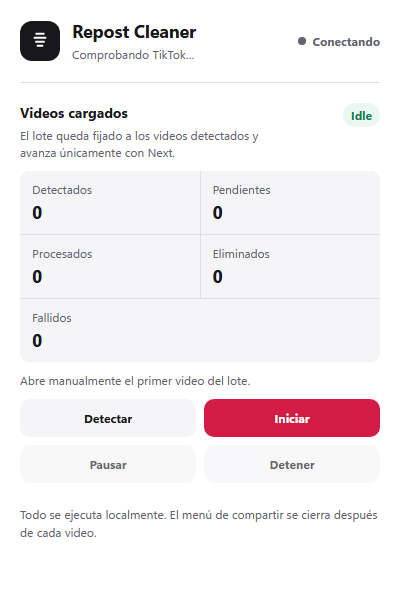

# TikTok Repost Cleaner

A local Microsoft Edge (Chromium) extension for removing reposts from the TikTok account already signed in to the browser.

> **Status:** experimental. TikTok can change its DOM at any time. Review the detected count before starting and test with a small set first.

## What it does

- Detects the TikTok posts currently loaded in the page DOM.
- Supports both `/video/{id}` and `/photo/{id}` posts.
- Locks each run to the exact set of detected post IDs.
- Removes reposts one at a time using TikTok's visible Share menu.
- Advances with TikTok's native **Next video** control instead of assigning URLs directly.
- Closes residual Share dialogs before processing the next post.
- Pauses, resumes, or stops a persistent local queue.
- Never repeats the removal click when post-action verification is inconclusive.
- Runs entirely inside Edge and does not transmit account data.

## Install in Microsoft Edge

1. Download or clone this repository.
2. Open `edge://extensions`.
3. Enable **Developer mode**.
4. Select **Load unpacked**.
5. Choose this repository's folder.
6. Reload any TikTok tab that was already open.

## Usage

1. Open your TikTok profile and select the reposts tab.
2. Scroll until every post you want to process has been loaded.
3. Open the first repost manually.
4. Open the extension popup and select **Detect**.
5. Review the number of detected posts.
6. Select **Start** once and avoid interacting with the TikTok tab while it runs.

The popup displays detected, pending, processed, removed, and failed counts. A run can be paused, resumed, or stopped.

## Safety behavior

- The queue contains only IDs observed in loaded `/video/` and `/photo/` links.
- Direct browser navigation such as `tabs.update()` or assigning `location.href` is not used.
- Removal requires a matching, short-lived per-post authorization stored locally.
- Failures before the final click may receive one safe retry.
- Failures after the click are never retried, because the repost may already have been removed.
- HTTP 403 pages and authorization failures stop the run.

## Permissions

- `activeTab` — communicates with the active TikTok tab after the popup is opened.
- `storage` — stores queue state and local progress.
- `https://www.tiktok.com/*` — injects the content script only on TikTok.

The extension does not request access to other websites, passwords, cookies, or authentication tokens.

## Development

After changing the source:

1. Open `edge://extensions`.
2. Select **Reload** on the extension card.
3. Reload the TikTok tab so the updated content script is installed.

Useful console messages are prefixed with `[TikTok Repost Cleaner]`.

## Project structure

- `manifest.json` — Manifest V3 configuration.
- `background.js` — service worker and queue message routing.
- `safe-queue-manager.js` — persistent allowlisted batch processor.
- `content.js` — TikTok tab messaging and native navigation helpers.
- `single-video-runner.js` — semantic Share-menu removal state machine.
- `dom-inspector.js` — read-only semantic DOM diagnostics.
- `popup.html`, `popup.css`, `popup.js` — extension controls and progress UI.

## Disclaimer

This project is not affiliated with TikTok. Automated activity may be subject to TikTok's terms and rate limits. Use it only on your own account and at your own risk.
